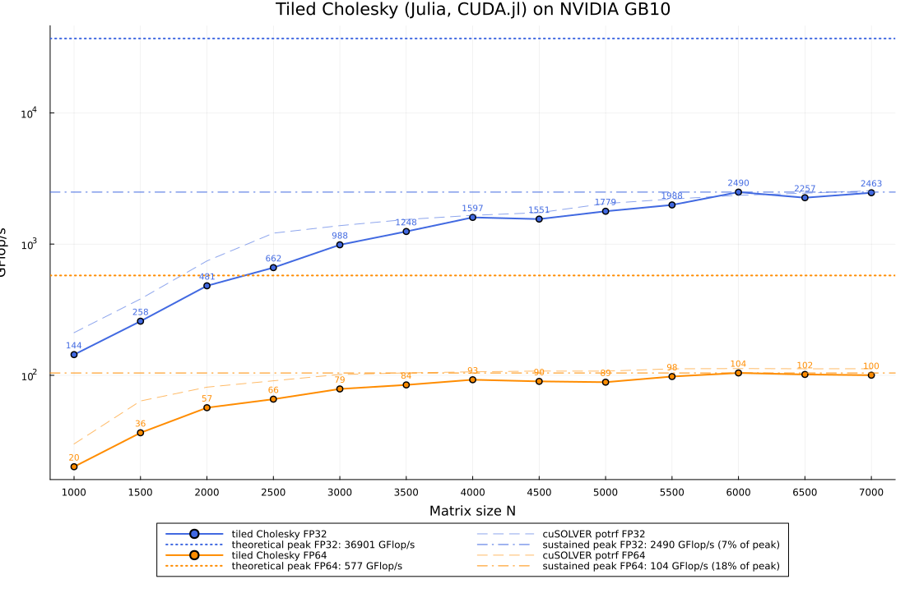

# Hat-AKT26

**Al-Khawarizmi Tour · Online Hackathon HPC & AI** · 3 Oct – 7 Nov 2026

Team **Dos-Kallas** · #1013

Five weekly challenges, from cleaning real air-quality data to a tiled Cholesky solver running on an NVIDIA GB10 through Slurm.



## Assignments

| Week | Challenge | Stack | Main result | Open |
|---|---|---|---|---|
| 1 | Air-quality data challenge: audit and clean a corrupted multi-station export | Python, pandas, scikit-learn | Cleaning lowers test RMSE in 5 of 5 seeds (mean gain 0.53 ± 0.22 µg/m³) | [Notebook](Assignment1/L1_Air_Quality_Data_Preprocessing_Notebook_Dos-Kallas.ipynb) |
| 2 | AI methods shoot-out: virtual PM2.5 sensor, unhealthy-air alert, regimes, 24 h forecast | Python, scikit-learn | Test-year RMSE 38.99 µg/m³, R² 0.78; alert recall 0.94 | [Notebook](Assignment2/L2_Air_Quality_AI_Methods_Notebook_Dos-Kallas.ipynb) |
| 3 | Cholesky performance on the CPU: threads, tiling, precision, BLAS, roofline | Julia | Tiled + BLAS at N = 4096: 155 GFlop/s, 1.8× LAPACK | [Notebook](Assignment3/L2_Cholesky_Performance_Julia_Notebook_Dos-Kallas.ipynb) |
| 4 | GPU programming: Hello World, AXPY, dot, GER, batched GEMM, each against cuBLAS | CUDA C++ | Hand-written kernels checked against a CPU reference | [Code](Assignment4/akt26_gpu_dev/) |
| 5 | Green Speed Run: tiled Cholesky on a GPU cluster | Julia, CUDA.jl, Slurm | 2,490 GFlop/s FP32 on the GB10, every run passes η ≤ 10Nε | [Notebook](Assignment5/L2_Cholesky_GPU_AutoHPC_Julia_Notebook_Dos-Kallas.ipynb) · [Code](Assignment5/src/cholesky_gpu.jl) |

## Repository layout

```text
Hat-AKT26/
├── Assignment1/            Week 1 · data preprocessing (Python)
│   ├── *.ipynb
│   ├── beijing_air_quality_raw.csv.gz      UCI data, cached by the notebook
│   └── beijing_merged_team1013.csv.gz      our team's corrupted export
├── Assignment2/            Week 2 · AI methods (Python)
│   ├── *.ipynb
│   └── beijing_clean_team1013.csv.gz       cleaned output of Week 1
├── Assignment3/            Week 3 · CPU Cholesky (Julia)
│   ├── *.ipynb
│   ├── bench_team1013.csv                  benchmark rows
│   └── results_team1013.json               results, answers and checks for grading
├── Assignment4/            Week 4 · CUDA C++
│   └── akt26_gpu_dev/0-hello-world … 4-gemm/   one folder and makefile per exercise
└── Assignment5/            Week 5 · GPU Cholesky on the AutoHPC cluster (Julia)
    ├── *.ipynb                             checks, tile-size sweep, final graph
    ├── Project.toml, Manifest*.toml        pinned CUDA.jl 6.5 (Julia 1.12 and 1.13)
    ├── src/cholesky_gpu.jl                 GPU code and benchmark driver
    ├── src/prefetch_artifacts.jl           downloads aarch64 CUDA artifacts ahead of time
    ├── slurm/                              setup_gpu.slurm, run_gpu.slurm
    ├── results/                            final CSV + exploration runs
    ├── figures/                            performance graph
    └── Notes/HPC_PLAN.md                   cluster facts, GPU budget, run plan
```

## Results

### Week 1 · Data quality

Each team receives a copy of the [UCI Beijing Multi-Site Air Quality](https://archive.ics.uci.edu/dataset/501/beijing+multi+site+air+quality+data) data (12 stations, 2013–2017, 420,768 hourly rows) with merge errors injected into the three training years. The final year stays untouched as the test set.

- The audit covers six quality dimensions: completeness, uniqueness, validity, accuracy, timeliness and consistency. Among the findings are duplicate station-hours, −999 codes, inconsistent labels, a CO unit error at Nongzhanguan in 2014 and a time shift of about 8 hours at Dingling in 2015.
- Imputation study: interpolation works best for short gaps, KNN for 24-hour gaps. Every imputed value is flagged.
- The same gradient-boosting model trained on raw and on cleaned data gives test RMSE 37.20 and 36.88. Cleaning wins in 5 of 5 seeds and at all 12 stations on average.
- The cleaned training years (315,648 rows × 24 columns) are the input of Week 2.

### Week 2 · AI methods

- **Virtual sensor:** 8 regressors compared on the same `TimeSeriesSplit` folds. After tuning, `HistGradientBoostingRegressor` is the recommended model: test-year RMSE 38.99, MAE 22.52, R² 0.78. It is weakest in winter and on smog peaks above 150 µg/m³.
- **Unhealthy-air alert** (PM2.5 > 75): logistic regression, ROC-AUC 0.939. A cost-based threshold (a missed alert costs 5 false alarms) raises recall from 0.76 to 0.94.
- **Regimes:** PCA, k-Means and DBSCAN on daily 24-hour profiles.
- **Neural nets:** a one-hidden-layer network written in NumPy, then an MLP. For the 24 h forecast, gradient boosting on lag features beats persistence by 10 % RMSE.

### Week 3 · Cholesky on the CPU

From element-wise loops up to a tiled, multithreaded factorization that calls BLAS for each tile. Every implementation passes the backward-error test.

| N = 4096, 12 threads | Float64 | Float32 |
|---|---|---|
| Tiled + BLAS (ours) | **155 GFlop/s** · 0.147 s | **238 GFlop/s** · 0.096 s |
| LAPACK | 84 GFlop/s · 0.271 s | 187 GFlop/s · 0.122 s |

The notebook also covers Amdahl's law, the tile-size sweep, mixed precision with iterative refinement and a roofline analysis. It passes 36 of the 37 automatic checks.

### Week 4 · CUDA kernels

Five exercises. Each one times a hand-written kernel, checks it against a CPU reference and compares it with the cuBLAS call: `cublasSaxpy`, `cublasSdot`, `cublasSger` and strided batched `cublasSgemm`.

### Week 5 · Tiled Cholesky on the GPU

The Week 3 algorithm ported to CUDA.jl. Each step is a `potrf!`, a `trsm!` and a `syrk!`/`gemm!` call. Two variants: `:tile` makes one library call per tile, `:panel` merges the tiles of a step into one large call. It was run with Slurm on the AutoHPC cluster's **NVIDIA GB10** (DGX Spark, aarch64), for N = 1000 … 7000.

| | Best tiled | cuSOLVER `potrf` | Theoretical peak |
|---|---|---|---|
| FP32 | **2,490 GFlop/s** (N = 6000, nb = 3072) | 2,355 at the same N | 36,901 GFlop/s |
| FP64 | **104 GFlop/s** (N = 6000, nb = 3072) | 113 at the same N | 577 GFlop/s |

From N = 4000 the tiled version stays within about 15 % of cuSOLVER in FP32 (20 % in FP64) and beats it in FP32 at N = 6000. The GB10 runs FP64 at 1/64 of its FP32 rate, which explains the gap between the two curves. The cluster facts, the 3 GPU-hour budget and the step-by-step run plan are in [`HPC_PLAN.md`](Assignment5/Notes/HPC_PLAN.md).

## Getting started

```sh
git clone https://github.com/Patpoooot/Hat-AKT26.git
cd Hat-AKT26
```

### Python · Weeks 1–2

Python 3.12 (the notebooks were run with scikit-learn 1.9):

```sh
python -m venv .venv
```

Activate it with `.\.venv\Scripts\Activate.ps1` on Windows PowerShell or `source .venv/bin/activate` on macOS/Linux, then:

```sh
python -m pip install jupyterlab ipykernel numpy pandas matplotlib scipy "scikit-learn>=1.2" joblib
python -m jupyterlab
```

Run each notebook from top to bottom with its assignment folder as the working directory.

- The UCI data is already cached as `beijing_air_quality_raw.csv.gz`. Without it, the notebook downloads the archive (≈ 8 MB). With no internet access, it falls back to synthetic data with the same columns, so check the loader message.
- Week 2 reads `beijing_clean_team1013.csv.gz`. To use a fresh export from Week 1, copy that file from `Assignment1/` to `Assignment2/`.
- Week 2's `STEP = 3` keeps every third hour so the notebook runs faster. `STEP = 1` gives the final results.

### Julia · Week 3

Julia 1.9 or newer and JupyterLab. Run this once in the Julia REPL to get a kernel that uses all cores:

```julia
using Pkg
Pkg.add(["IJulia", "Plots"])
using IJulia
installkernel("Julia (auto threads)", env = Dict("JULIA_NUM_THREADS" => "auto"))
```

Open the notebook, select **Julia (auto threads)**, and set `QUICK = true` (or `CHOL_QUICK=1`) for a short run.

### CUDA · Week 4

An NVIDIA GPU, the CUDA Toolkit (`nvcc` and cuBLAS), a matching C++ compiler and Make.

```sh
cd Assignment4/akt26_gpu_dev/0-hello-world
make
./hello-world
```

On Windows, run `.\hello-world.exe`. The other folders work the same way and take optional sizes as arguments, for example `./axpy 1000000 10` or `./gemm 16 1000` (matrix size up to 32, batch size). The makefiles target `sm=80`; pass your GPU's compute capability with `make sm=86`, for example.

### Julia + CUDA · Week 5

Julia 1.12 or 1.13 and an NVIDIA GPU. From `Assignment5/`, install the pinned packages once, then run a short benchmark:

```sh
julia --project=. -e "using Pkg; Pkg.instantiate()"
CHOL_MODE=quick julia --project=. src/cholesky_gpu.jl
```

On Windows PowerShell, set the mode with `$env:CHOL_MODE = "quick"` first. Julia 1.12 picks up `Manifest-v1.12.toml` automatically.

| `CHOL_MODE` | What it runs | Output |
|---|---|---|
| `quick` | N = 1000, 2000, 3000 with two tile sizes, to check the setup | `results/exploration/results_gpu_team1013_quick.csv` |
| `explore` | every N, both variants, 7 tile sizes, plus cuSOLVER | `results/exploration/results_gpu_team1013_explore.csv` |
| `final` | every N with the best configuration found by `explore`, plus cuSOLVER | `results/results_gpu_team1013.csv` |

A new run replaces the CSV of its mode; `CHOL_CSV` writes elsewhere. `CHOL_SIZES`, `CHOL_NBS`, `CHOL_REPS` and `CHOL_TIME_BUDGET` (230 s by default) override the defaults. Each configuration gets one untimed warm-up, keeps the fastest of 3 timed runs, and records its backward error and GPU energy.

On the cluster, `slurm/setup_gpu.slurm` installs and compiles the packages on the GPU node once (the node is ARM while the login node is x86). `slurm/run_gpu.slurm` then runs the benchmark in a 5-minute job. Submit both from `Assignment5/`:

```sh
sbatch --export=ALL,CHOL_MODE=quick slurm/run_gpu.slurm
```

The notebook runs from `Assignment5/` and needs `Plots` in your default Julia environment. It reads `results/`, checks correctness, sweeps the tile size and saves the graph to `figures/`.

## Data & license

Weeks 1–2 use the [UCI Beijing Multi-Site Air Quality](https://archive.ics.uci.edu/dataset/501/beijing+multi+site+air+quality+data) dataset (Zhang et al., 2017, *Proc. R. Soc. A*). The lecture slides, notes and assignment briefs belong to the hackathon organizers and are not included in this repository.

Our code is available under the [MIT License](LICENSE).
